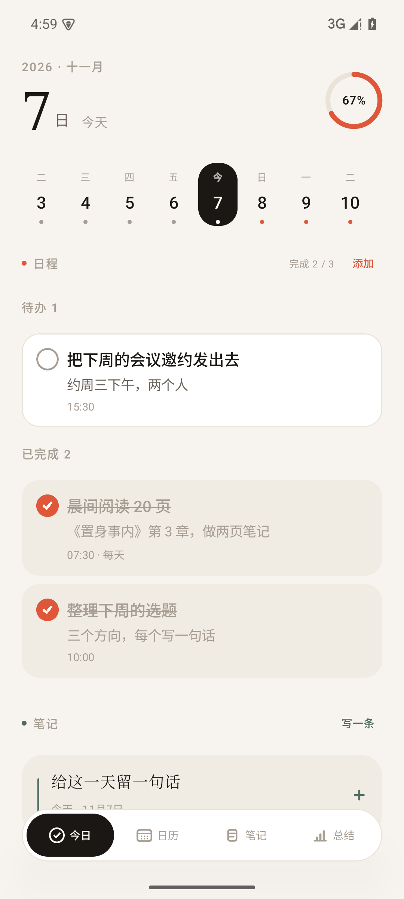
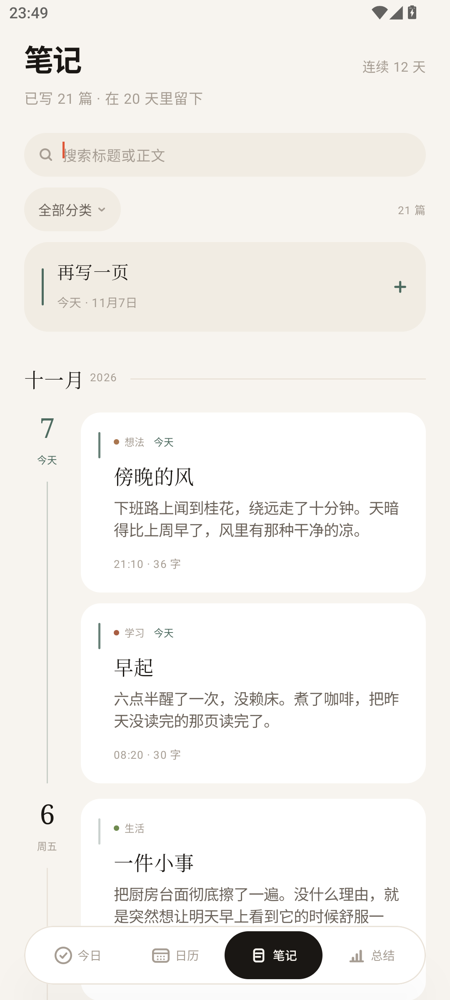
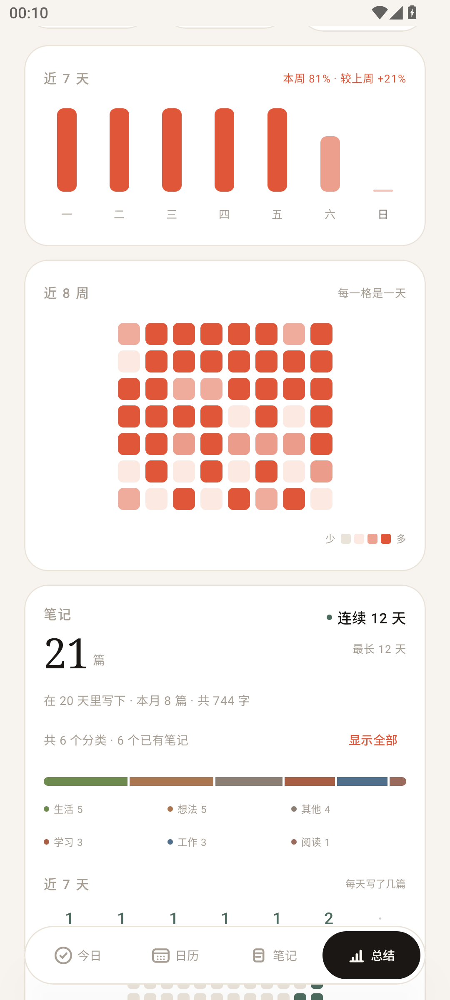
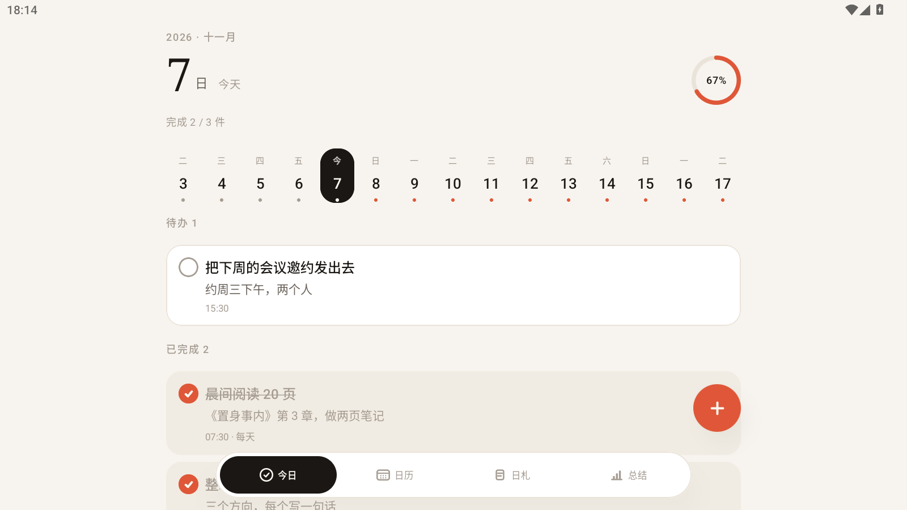
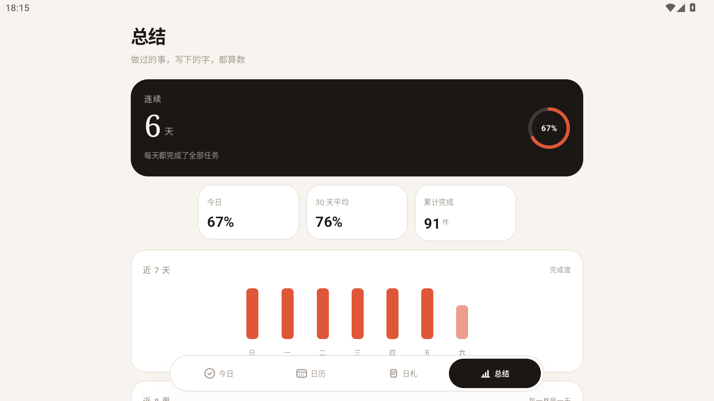

# 逐日 · Day by Day

> 一款纯本地、零广告、零账号的安卓待办与坚持记录 App。
> 提前给某一天安排任务，勾掉它；再写两笔笔记，然后看见自己坚持了多久。

<!-- 截图 -->
<p align="center">
  
</p>

<p align="center">
  
  
  
</p>

<p align="center">
  
  
</p>

## 特点

- **不用注册、不联网**：APK 里连 `INTERNET` 权限都没有，数据只存在自己手机里
- **提前安排**：日期条能滑到 45 天后，日历能翻任意月份；翻远了有一枚「今天」按钮直接跳回
- **会重复**：不重复 / 每天 / 每周几 / 每月某日
- **每天可写笔记**：一天多篇、标题可空、最近 7 天可补记；五类标签（想法 / 生活 / 工作 / 学习 / 其他）可筛选；不写也不影响任务连续
- **看得见坚持**：任务连续天数、30 天平均完成度、近 7 天柱状图、近 8 周热力图；笔记篇数、字数、写作连续与 12 周写作热力、分类占比
- **小**：Release 包 1.5MB，冷启动 ~0.4s
- **好认**：日程是赤陶色 + 圆形勾选，笔记是冷灰绿 + 衬线标题 + 分类圆点，一眼分得开
- **好看**：暖纸底色、自绘图标与启动动画，支持深色模式与 Android 13 主题图标
- **自适应**：手机铺满、平板 / 横屏居中限宽，导航与悬浮按钮跟随内容边界，320dp 到 1066dp 都试过

## 安装

从 [`artifacts/逐日-v2.1.apk`](artifacts/逐日-v2.1.apk) 下载，传到手机安装即可。
已在 MuMu（Android 15 / x86_64）实测安装启动；最低覆盖 Android 6.0。

- 最低系统：Android 6.0（API 23；`java.time` 已脱糖）
- 目标系统：Android 16（API 36）
- 首次安装需要允许「安装未知来源应用」

## 技术栈

| 层 | 选型 |
|---|---|
| 语言 | Kotlin 2.2.20 |
| UI | Jetpack Compose + Material 3（BOM 2025.09.01） |
| 构建 | AGP 8.12.3 + Gradle 8.13 + JDK 17 |
| 存储 | 本地 JSON（原子写入），无数据库、无网络 |
| 架构 | 单 Activity + StateFlow + Compose State |

运行时依赖只有五个：`core-ktx`、`activity-compose`、`lifecycle-runtime-compose`、`compose.ui`、`compose.material3`；
另加编译期 `desugar_jdk_libs`，让 Android 6/7 也能用 `java.time`。
没有 Room、没有 Hilt、没有 Navigation、没有图标扩展包——图标全部用 Canvas / VectorDrawable 自绘。

## 自己编译

```bash
# 1. 准备 SDK 路径
echo "sdk.dir=/path/to/Android/SDK" > local.properties

# 2. 编译
./gradlew assembleRelease     # 或用本机 gradle
# 产物：app/build/outputs/apk/release/app-release.apk
```

签名：仓库不含签名密钥。没有 `keystore.properties` 时，release 会自动退回 debug 签名，依然能装。
要打正式包，自己在项目根目录建 `keystore.properties`：

```properties
storeFile=signing/your.jks
storePassword=******
keyAlias=your_alias
keyPassword=******
```

## 文档

代码之外，这个仓库带了一套完整的开发文档，任何 AI 或开发者接手都能顺着读下去：

| 文档 | 内容 |
|---|---|
| [`AGENTS.md`](AGENTS.md) | **总入口**：定位、技术栈、目录地图、文档阅读顺序、构建命令 |
| [`docs/00-项目总览.md`](docs/00-项目总览.md) | 产品定位、功能边界、信息架构、用户旅程 |
| [`docs/01-目录结构与构建.md`](docs/01-目录结构与构建.md) | 每个文件的职责、构建环境、7 条踩坑记录 |
| [`docs/02-功能规格.md`](docs/02-功能规格.md) | 重复规则算法、统计口径、边界情况 |
| [`docs/03-视觉与交互规范.md`](docs/03-视觉与交互规范.md) | 色板、字号、间距、动效、组件尺寸、图标几何 |
| [`docs/04-数据与状态.md`](docs/04-数据与状态.md) | JSON Schema、读写时机、迁移策略 |
| [`docs/05-验收与测试.md`](docs/05-验收与测试.md) | 验收清单、性能指标、已知限制 |
| [`docs/CHANGELOG.md`](docs/CHANGELOG.md) | 每次改动的原因 |

## 目录

```
.
├── AGENTS.md              # 总操作文档（先读这个）
├── docs/                  # 分层文档
├── app/src/main/java/com/zhuri/daybyday/
│   ├── model/Task.kt          # 任务模型 + 重复规则
│   ├── model/Diary.kt         # 笔记模型 + 写作统计
│   ├── data/TaskRepository.kt # 状态 + JSON 持久化
│   ├── ui/                    # 今日 / 日历 / 笔记 / 总结 / 编辑器 / 启动动画
│   └── ui/theme/Theme.kt      # 设计令牌（唯一颜色来源）
├── artifacts/             # 安装包与截图
└── scripts/               # 演示数据生成、图标预览渲染
```

## 协议

个人项目，代码可自由参考。图标与名称请勿直接商用。
